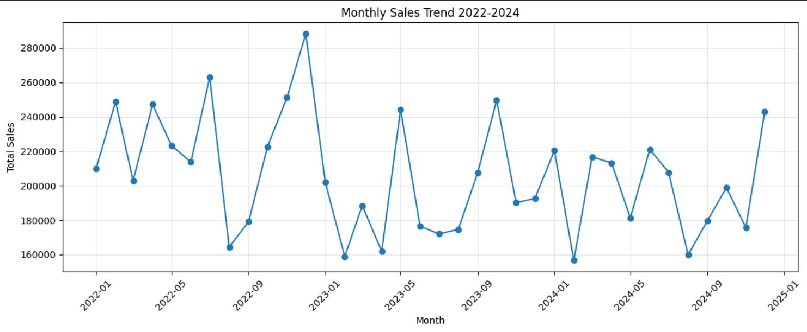
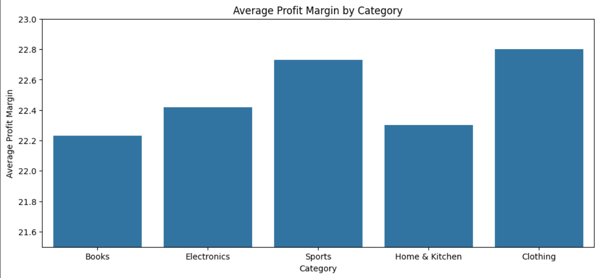
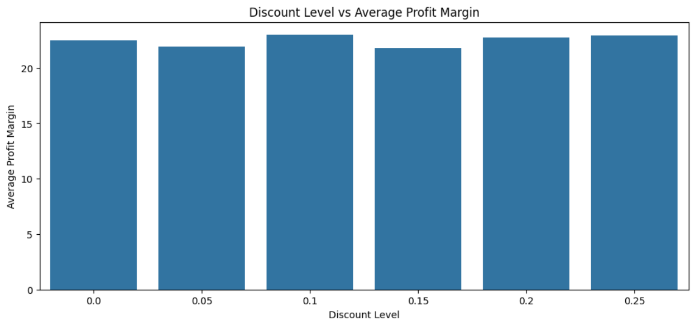
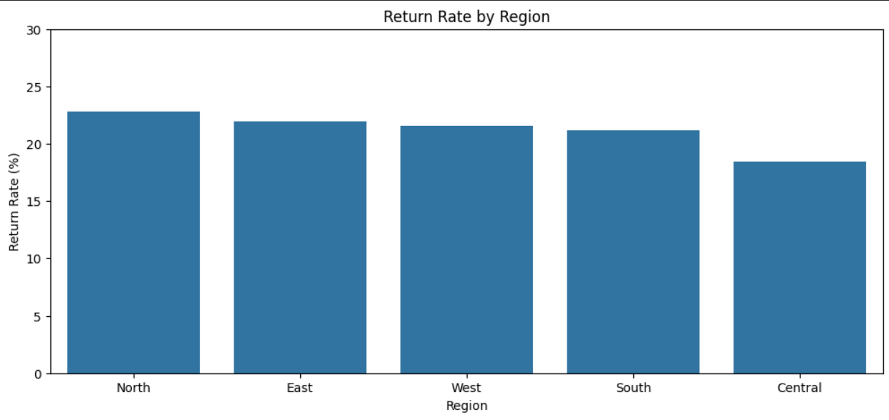
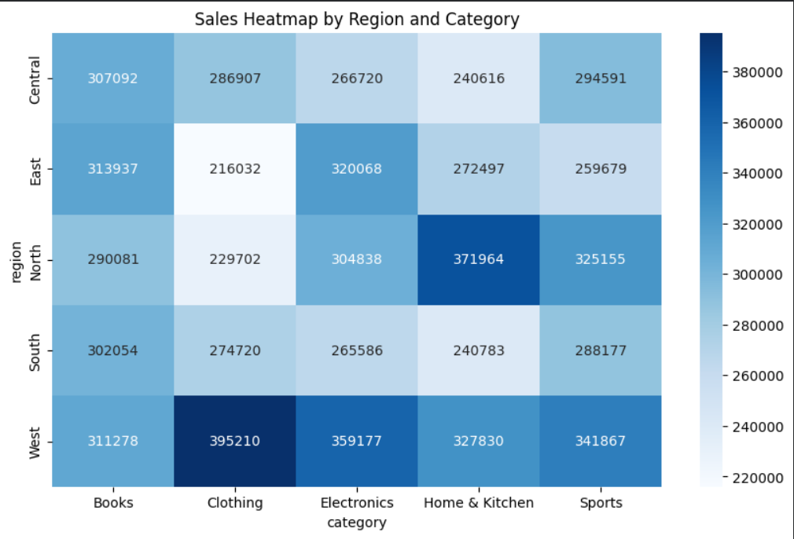

# RetailIQ: Python EDA

## Project Overview
Exploratory data analysis of 2,000 e-commerce orders (2022-2024) using
Python. This is the Python phase of the RetailIQ project. The same
business questions were first answered in Google Sheets and MySQL, and
results were cross-validated across all three tools.

SQL project: [RetailIQ-SQL-Analysis](https://github.com/basil940/RetailIQ-SQL-Analysis)

## Dataset
| Field | Details |
|---|---|
| Source | Synthetic retail orders dataset |
| Rows | 2,000 |
| Columns | 20 (24 after feature engineering) |
| Period | 2022 to 2024 |

## Tools Used
- Python, Google Colab
- pandas, matplotlib, seaborn

## What I Did
1. **Data quality checks:** shape, data types, nulls (none) and duplicates (none)
2. **Cleaning and feature engineering:** converted dates to datetime and created `order_year`, `order_month`, `profit_margin` and `shipping_days`
3. **Aggregations:** `groupby` summaries by region, category and month
4. **Visualisation:** 5 charts (line, bar and heatmap)
5. **Cross-validation:** results matched MySQL and Google Sheets

## Key Insights
- **Sales fell ~15% in 2023 and stayed flat in 2024.** Totals were
  ₹27.14L (2022), ₹23.19L (2023) and ₹23.74L (2024).
- **Category margins are nearly identical** (22.2% to 22.8%). Books
  lead in sales but have the lowest margin, though the gap is small.
- **Discounts did not change margin % or quantity sold.** Lower profit
  on discounted orders comes from lower order value, not margin erosion.
- **Central has the lowest return rate (18.4%).** The other regions sit
  between 21.2% and 22.8%, and about 1 in 5 orders is returned overall.
- **West x Clothing is the strongest region-category cell (₹3.95L)**
  and East x Clothing the weakest (₹2.16L).

*Note: the dataset is synthetic, so small differences between groups
may be random noise.*

## Charts

### Monthly Sales Trend

### Average Profit Margin by Category

### Discount Level vs Profit Margin

### Return Rate by Region

### Sales Heatmap: Region x Category

